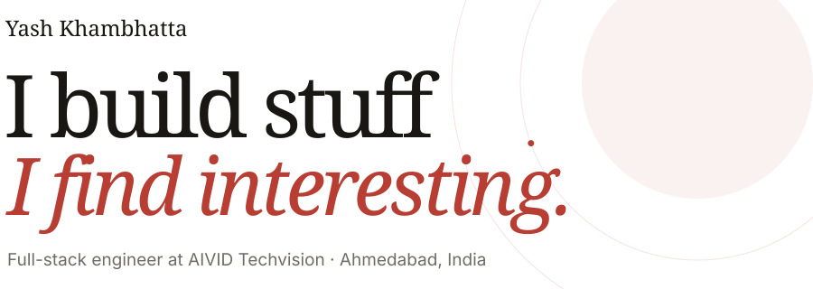
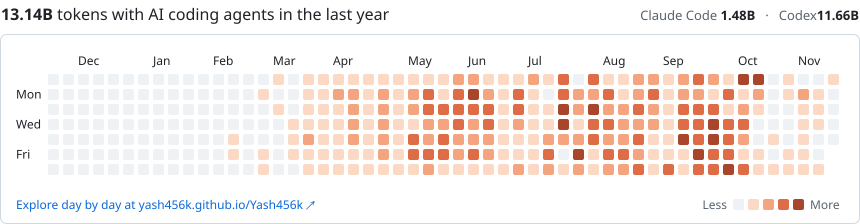

<picture>
  <source media="(prefers-color-scheme: dark)" srcset="assets/hero-dark.svg">
  
</picture>

 
 

<a href="https://yash456k.github.io/Yash456k/">
<picture>
  <source media="(prefers-color-scheme: dark)" srcset="assets/activity-dark.svg">
  
</picture>
</a>

 
 

 
 

| Project | What it is | Measured |
|---|---|---|
| [Ask my portfolio](https://github.com/Yash456k/ask-my-portfolio) | The chat on my site, answering with its sources | Right passage first on all 225 answerable test questions, 20 points ahead of the best embedding model |
| [HiveNote](https://github.com/Yash456k/hivenote) | Shared notes and tasks for AI agents, on npm | 100 agents claiming one task at once, 1,000 times: exactly one winner every time |
| [Nashik Sports Klub](https://github.com/Yash456k/NSK-Project-Public) | A live court booking site for a sports club | 500 simulated users on one slot: exactly one booking went through |

 

[yash456k.com](https://www.yash456k.com) · [x.com/yash654k](https://x.com/yash654k) · yashkhambhattak@gmail.com

